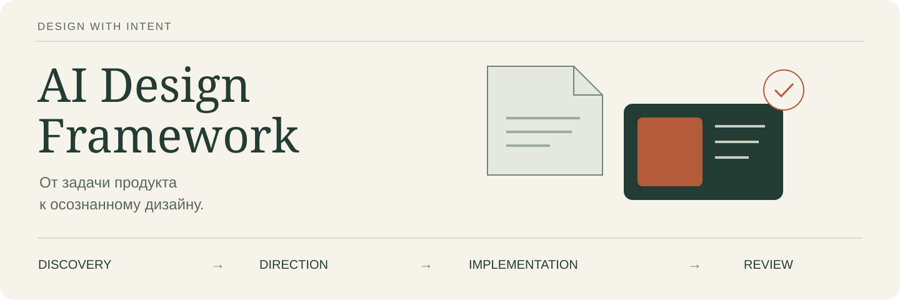
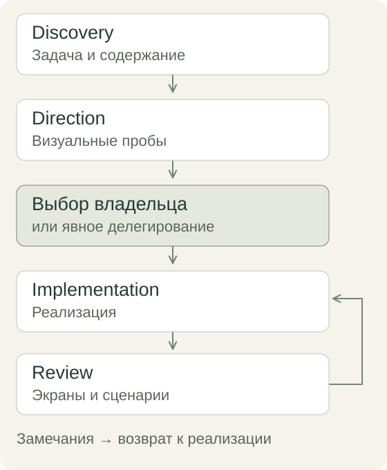

<p align="center">
  
</p>

<p align="center">
  <a href="LICENSE"></a>
  
  
</p>

# AI Design Framework

**Помогает AI-агенту пройти путь от задачи сайта до работающего и проверенного дизайна.**

Четыре скила для исследования, выбора визуального направления, реализации и review.
Внутри — инструкции, шаблоны документов, критерии готовности и три дополнительных
скила для элементов сайта, крайних данных и мобильного поведения.

Подходит для лендингов, сайтов услуг, блогов, коллекций и интернет-магазинов.
Основная проверенная среда — Codex. Инструкции можно адаптировать для другого агента,
который умеет читать локальные файлы; автоматическое обнаружение и инструменты
других клиентов здесь не проверялись.

[Быстрый старт](#быстрый-старт) · [Как пользоваться](docs/GETTING-STARTED.md) ·
[Примеры запросов](docs/EXAMPLES.md) · [Что проверено](docs/VALIDATION-RESULTS.md) ·
[Участие](CONTRIBUTING.md)

## Зачем он нужен

Запрос «сделай красивый сайт» оставляет агенту слишком много неявных решений:
для кого сайт, какое содержание настоящее, чем варианты отличаются, что уже выбрал
владелец и как проверить результат. Этот фреймворк делает решения явными и сохраняет
их между этапами.

Вы получаете:

- **Бриф и структуру**, связанные с задачей пользователя и доступными материалами.
- **Сравнимые визуальные направления** на одинаковом содержании, с мобильной версией.
- **Дизайн-контракт** с выбранной композицией, типографикой, токенами и ограничениями.
- **Реализацию с доказательствами**: версия, реальные страницы, взаимодействия и ограничения.
- **Review с воспроизведением замечаний**, просмотренными экранами и повторной проверкой исправлений.

Конкретные шрифты, палитра, радиусы и стиль принадлежат вашему проекту.
Карточки и градиенты оцениваются по задаче и требованиям владельца.
Нумерация передаёт значимый порядок; равноправные секции оформляются без номеров.
Для ссылок и кнопок действует [правило текстовых подписей без декоративных стрелок](docs/framework/STYLE-RULES.md).

## Что изменилось в 0.5.0

В существующие direction, implementation и review встроены приёмы clarify,
typeset и polish: правдивые тексты состояний, читаемая типографика и исправление
причины визуального расхождения. Сохраняются принятый бренд, компоненты проекта
и границы правки. Новый пакет или runtime не требуется.

Правило смысловой нумерации уточнено для четырёх основных навыков и elements:
равноправные результаты, услуги и секции оформляются без порядковых номеров.

[Изменения и происхождение](docs/research/impeccable-adaptation-2026-10-22.md) ·
[Шесть сценариев, восемь исполнений](docs/VALIDATION-RESULTS.md#text-type-polish-0-5-0) ·
[Выпуск 0.5.0](https://github.com/tduhfajd/AI-Design-Framework/releases/tag/v0.5.0).
Оба baseline также успешны; причинный прирост надёжности не доказан.
Открытое ограничение учебного интерфейса при 200% сохранено в отчёте.

### Сохранено из 0.4.1

Discovery, implementation и review связывают все явные требования заданного
объёма с исходным документом, наблюдаемым условием и доказательством.
Для первого экрана фиксируются ширина × высота и состояние; у клавиатурного
действия проверяется конечный фокус или результат. Production-сборка с другими
флагами не должна незаметно менять работающий preview.

[Разбор и изменения](docs/retrospectives/requirements-coverage-2026-10-19.md) ·
[Четыре сценария, шесть независимых исполнений](docs/VALIDATION-RESULTS.md#requirements-0-4-1).
Оба baseline на 0.4.0 тоже успешны: рост надёжности на большой выборке не доказан.
Новых этапов, обязательных концепций и библиотек нет.
[Выпуск 0.4.1](https://github.com/tduhfajd/AI-Design-Framework/releases/tag/v0.4.1).

### Сохранено из 0.4.0

Новый [ai-design-elements](.agents/skills/ai-design-elements/SKILL.md) помогает
подбирать, адаптировать и проверять формы, меню, карточки, таблицы, секции и движение.
Сначала используются компоненты вашего проекта; внешние кандидаты проверяются
по исходнику, правам, зависимостям и действующему дизайну.

В пакете — каталог 43 источников и Python CLI без зависимостей: поиск на русском
и английском, фильтры, локальные записи, создание черновика и проверка реестра.
React, Tailwind и MCP не обязательны. Каталог не устанавливает и не одобряет код,
а `verified-record` проверяет полноту записи, а не истинность UI-проверок.

[Восемь независимых сценариев и повтор](docs/VALIDATION-RESULTS.md#elements-0-4-0)
выявили пропуск английского поиска для Svelte; исправление подтверждено свежим
исполнителем. Все 23 переносимых теста элементов проходят.
[Использование и команды](docs/framework/ELEMENTS.md) · [Изменения выпуска](CHANGELOG.md).

### Сохранено из 0.3.0

В четыре этапа встроен [стандарт качества](docs/framework/QUALITY.md): реестр
verified/placeholder/missing, обоснование структуры, основания замечаний A/B/C,
приоритеты P0/P1/P2 и матрица готовности по проверенному объёму. Принятый бренд
и локальные исправления сохраняются; новые концепции нужны при выборе направления.

[Восемь Q-сценариев и T-22](docs/VALIDATION-RESULTS.md#quality-0-3-0)
выполнены в отдельных контекстах. Ошибки обвязки, границы проверки и авторская
оценка сохранены. Это не доказательство устойчивости на всех сайтах и моделях.
[Changelog и обновление существующего проекта](CHANGELOG.md).

## Как устроен процесс



Этап выбирается по задаче. Для исправления меню достаточно implementation и review.
При наличии утверждённого макета можно сразу переходить к переносу.
[Маршруты работы](docs/framework/ROUTES.md) объясняют эти случаи подробнее.

## Скилы

| Скил | Когда использовать | Основной результат |
| --- | --- | --- |
| [ai-design-discovery](.agents/skills/ai-design-discovery/SKILL.md) | Новый сайт, неясная задача, изменение аудитории | `BRIEF.md`, структура и неизвестное |
| [ai-design-direction](.agents/skills/ai-design-direction/SKILL.md) | Нужно выбрать или существенно пересмотреть стиль | Визуальные пробы, `DIRECTIONS.md`, после выбора `DESIGN.md` |
| [ai-design-implementation](.agents/skills/ai-design-implementation/SKILL.md) | Реализация выбранного дизайна, перенос в CMS, локальная правка | Работающий интерфейс и `IMPLEMENTATION.md` |
| [ai-design-review](.agents/skills/ai-design-review/SKILL.md) | Проверка отрисованных страниц и пользовательского пути | `REVIEW.md` с доказательствами |
| [break-ui](.agents/skills/break-ui/SKILL.md) | Длинный текст, пропуски, большие и маленькие коллекции | Проверка реалистичных крайних данных |
| [mobile-native](.agents/skills/mobile-native/SKILL.md) | Touch/hover, viewport, ввод, прокрутка | Мобильная проверка или разрешённое исправление |
| [ai-design-elements](.agents/skills/ai-design-elements/SKILL.md) | Подбор, адаптация, ревью и повторное использование элемента | Выбор, происхождение, права и доказательства; каталог/CLI |

`break-ui` и `mobile-native` — адаптации работ Emil Kowalski, с сохранёнными
[источниками и лицензиями](CREDITS.md). Они подключаются по задаче внутри implementation/review.

## Быстрый старт

Нужны Codex с поддержкой локальных skills и существующий проект сайта.
Для установщика нужен Python 3.10+; сторонние Python-пакеты не требуются.
Браузер, сборка, CMS и их зависимости определяются вашим сайтом.

```sh
git clone https://github.com/tduhfajd/AI-Design-Framework.git
cd AI-Design-Framework
python3 scripts/install.py --project /path/to/your/site --dry-run
python3 scripts/install.py --project /path/to/your/site
```

Замените `/path/to/your/site` на каталог своего сайта. Скрипт копирует семь пакетов
в его `.agents/skills/`. Существующие отличающиеся скилы вызывают остановку **до копирования**;
одинаковые пропускаются. Код сайта и его `AGENTS.md` сохраняются.

Откройте **проект сайта** в Codex. Если скилы не появились, перезапустите Codex.
Проверьте список skills и начните, например, так:

```text
Используй $ai-design-discovery. Изучи этот проект и доступные материалы.
Нужен лендинг мастерской: посетитель должен понять формат занятия и оставить заявку.
Подготовь бриф, структуру и основной сценарий. Код пока не меняй.
Неизвестные факты и недостающие материалы отметь отдельно.
```

Следующий запрос после готового брифа:

```text
Используй $ai-design-direction по design/BRIEF.md.
Покажи два действительно разных направления на одинаковом содержании,
на компьютере и телефоне. Я выберу после просмотра.
```

Для правил команды можно вручную добавить [короткое дополнение](docs/AGENTS.addendum.md)
в существующий `AGENTS.md`. [Подробная установка](docs/GETTING-STARTED.md) включает
ручное копирование, установку одного скила и обновление существующих пакетов.

## Что появляется в вашем проекте

```text
design/
  BRIEF.md             Задача, аудитория, содержание, структура
  CONTENT.md           Реестр фактов/материалов, если нужен отдельный файл
  REFERENCES.md        Наблюдения о доступных референсах
  DIRECTIONS.md        Варианты, сравнение, рекомендация и выбор
  DESIGN.md            Принятые визуальные решения
  ELEMENTS.json        Реестр решений по элементам, если нужен отдельный файл
  IMPLEMENTATION.md    Реализация, версия и проверки
  REVIEW.md            Покрытие, замечания и ограничения
  previews/            Визуальные пробы
  evidence/            Доказательства проверки
```

Документы создаются по необходимости. Готовые эквиваленты в вашем проекте имеют
приоритет. Шаблоны находятся внутри каждого скила — отдельная установка шаблонов
не нужна.

## Что уже проверено

В разработке выполнены изолированные поведенческие прогоны, включая полный показ
двух направлений и перенос в настоящие WordPress/WooCommerce на MariaDB.
Проверялись редакторский save/reload, подписи и порядок изображений, корзина,
checkout, сохранность авторского содержания и оригиналов.

Испытания выявили ошибки: общий registry браузерных сессий, неудобное HTML-редактирование
одного переноса и пропущенную review тень подписи. Два CMS-прогона повторены на свежих
базах новыми исполнителями. История не превращена в «все тесты зелёные».

**Статус — experimental, редакция 0.5.0.** Методология проверена на ограниченном
наборе сценариев. Качество каждого дизайна оценивается отдельно: по задаче проекта,
содержанию, визуальной иерархии, адаптивности и удобству основного пользовательского
пути. Визуальное направление выбирает владелец или агент по его явному делегированию.
[Обзор испытаний, найденных ошибок и снимки](docs/VALIDATION-RESULTS.md).

## Проверка этого репозитория

```sh
python3 scripts/validate.py
python3 -m unittest discover -s tests/unit -v
```

Первая команда проверяет состав пакетов, контрольные суммы, локальные ссылки
и известные маркеры приватного контекста. Вторая проверяет установщик, его отказы
и CLI/реестр элементов. Служебный Python bytecode не входит в пакет или сравнение установки.
Те же команды включены в GitHub Actions. Они **не запускают агентов, браузер или CMS**
и не оценивают качество дизайна. [Протокол поведенческих испытаний](docs/framework/VALIDATION.md).

## Навигация

- [Контракты четырёх скилов](docs/framework/CONTRACTS.md) — входы, действия, критерии завершения.
- [Маршруты](docs/framework/ROUTES.md) — новый сайт, редизайн, локальная правка и аудит.
- [Стандарт качества](docs/framework/QUALITY.md) — содержание, доказательства и готовность.
- [Специализации](docs/framework/SPECIALIZATIONS.md) — крайние данные и мобильное поведение.
- [Элементы сайтов](docs/framework/ELEMENTS.md) — выбор источника, адаптация, происхождение и проверка.
- [Примеры](docs/EXAMPLES.md) — готовые запросы и небольшой учебный бриф.
- [Roadmap](ROADMAP.md) — известные ограничения и следующие проверки.
- [Changelog](CHANGELOG.md) — состав этой редакции.

## Лицензия и авторство

[MIT](LICENSE). Автор — [Вадим Евграфов](https://github.com/tduhfajd).
Происхождение адаптаций указано в [CREDITS.md](CREDITS.md).
