# Проверенные возможности и ограничения

## 0.5.0: тексты, типографика и доводка

22 октября 2026. [Сценарии](../tests/behavioral/TEXT-TYPE-POLISH-CASES.md),
[машиночитаемая сводка](../tests/evidence/2026-10-22-text-type-polish/summary.json).
Восемь отдельных свежих контекстов: шесть candidate-v1 и два baseline
(CTP-01/03). Before-adaptation включает локальные изменения поверх 0.4.1,
не является чистым публичным 0.4.1. Оценщик — автор адаптации, не внешний эксперт.

| Сценарий | Результат по плану |
| --- | --- |
| CTP-01 baseline и candidate | Только copy.js, пять осмысленных состояний, сохранение ввода/локального черновика, без ложной доставки |
| CTP-02 | Read-only review находит ложную отправку, retry при запрете, неясные подписи и пустые сообщения |
| CTP-03 baseline и candidate | Только CSS, полная статья и три шага, Arial/палитра, узкий/широкий вид и увеличенный текст |
| CTP-04 | Независимый осмотр находит overflow и обрезку; scanner и старый отчёт не заменяют наблюдение |
| CTP-05 | Возврат к принятой общей primary, без правки токенов/эталона; реальный клавиатурный путь до контакта |
| CTP-06 | Две разные полные типографические пробы, тот же текст/бренд; выбор и внедрение не присвоены владельцу |

Все восемь исполнений соответствуют условиям плана. **CTP-01 candidate оставляет
PARTIAL для всего интерфейса**: дополнительная установка CSS root text 200%
даёт существующий H1 overflow до 467px на viewport 390px. Разрешён только copy.js;
текстовая правка готова, HTML/CSS не изменялись. Разделение preview saved и
реальной записи также ограничено неизменяемым engine: текст объясняет назначение
кнопки, фактическая запись подтверждена sessionStorage после действия.

Оба baseline успешны, поэтому причинный прирост надёжности не доказан.
Подтверждённого пробела навыков нет; второй редакции и свежего повтора после
исправления не было. Ошибки настройки CLI/socket и fullPage-захвата исправлялись
в обвязке. Артефакт tiled PNG не считался доказательством: получены и просмотрены
viewport-снимки со скроллом. Автор отдельно повторил формы, CSS-исправления,
primary и две пробы в браузере. SHA подтверждают границы записи и неизменность
изолированных пакетов; это контроль конечных файлов, не OS sandbox.

Выбранные изображения — viewport 390×844, не полные страницы:

| Исходная статья | Исправленная статья |
| --- | --- |
| 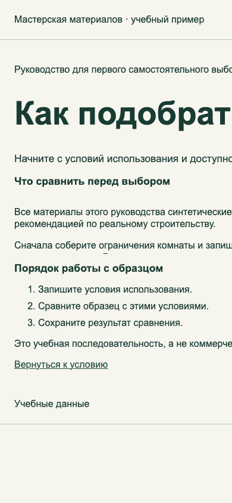 | 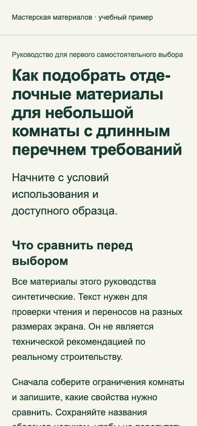 |

| Свободное чтение | Собранный ритм |
| --- | --- |
| 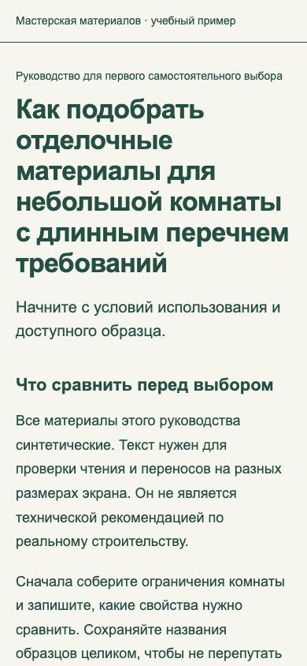 | 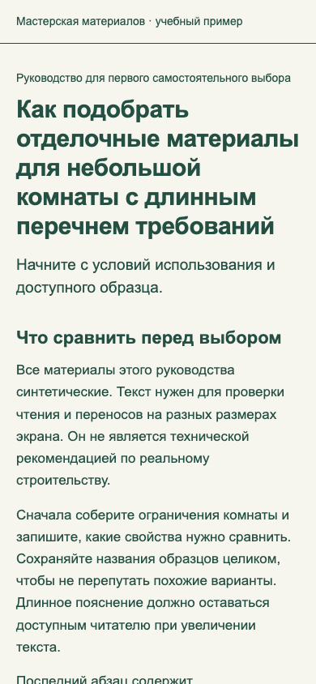 |

Две полные синтетические HTML-пробы можно открыть локально:
[Свободное чтение](../tests/evidence/2026-10-22-text-type-polish/probes/open/index.html),
[Собранный ритм](../tests/evidence/2026-10-22-text-type-polish/probes/precise/index.html).
Они иллюстрируют сравнение внутри одного бренда, а не общий стиль фреймворка.

Среда: Playwright-bundled Chromium 155.0.8059.12, отдельные профили, loopback,
два viewport 390×844/1440×1000. Увеличение — CSS root font-size, не настоящий
browser zoom; viewport — не физический телефон. Фоновый favicon 404 отделён
от ресурсов проекта. Webfont отсутствует; Arial подтверждён CDP в типографике.
Не проверялись screen reader, полное WCAG, field CWV, реальная доставка и
продуктовые метрики. Формат, ссылки, manifest, установка и unit tests — отдельные
механические проверки, они не запускают эти агентные прогоны.

---

Дата текущего среза — 19 октября 2026 года; старые наборы ниже сохраняют свои версии. Здесь опубликован **обзор внутренних испытаний**
и выбранные снимки синтетического проекта. Полные диалоги, базы, runtime и частные
пути не включены. Это не внешняя экспертиза и не оценка вероятности успеха.

## Какие уровни различаются

| Уровень | Что подтверждает |
| --- | --- |
| `scripts/validate.py` | Состав файлов, суммы, локальные ссылки, обязательные поля и известные маркеры частного контекста |
| Unit tests установщика | Копирование, повторный запуск, отказ при конфликте и symlink, dry-run |
| Поведенческий прогон | Фактические решения агента на конкретном запросе и в конкретной среде |
| Просмотр рендера | Видимое качество конкретных экранов; DOM и созданный PNG сами по себе его не подтверждают |
| Решение владельца | Принятие результата в согласованных границах |

## Редакция 0.4.1 — 19 октября 2026

После пилота карьерного лендинга уточнены покрытие явных условий и доказательства
в discovery, implementation и review. В пилоте условие первого экрана было
пропущено при локальной оценке готовности, хотя общая инструкция уже требовала
проверять требования проекта. Это ошибка исполнения, а не доказанная неспособность
старого навыка выполнить задачу.

| Исполнение | Редакция | Результат |
| --- | --- | --- |
| DR-01-baseline | 0.4.0 | PASS: найдены оба нарушения — начало опыта y=1072 при 390×844 и hash без фокуса main |
| DR-01R | candidate-v1 | PASS: те же нарушения найдены при том же запросе и исходниках |
| DR-02 | candidate-v1 | PASS: изменён только HTML; опыт y=717.6875 после портрета, main получает фокус, следующий Tab идёт к действию |
| DR-03-baseline | 0.4.0 | PASS: production bundle сразу записан отдельно от активного preview |
| DR-03R | candidate-v1 | PASS: отдельный output; байты и mtime preview сохранены |
| DR-04 | candidate-v1 | PASS: бриф сохраняет все условия и источники; план проверки не назван выполненным аудитом |

Шесть отдельных контекстов без истории автора получили только собственный запрос,
учебный проект и самодостаточный пакет навыка. Критерии оценки и результаты других
исполнений им не передавались. Формальный план записан во время baseline-прогонов,
не до их старта. DR-02 и DR-04 не имеют заявленного baseline.

Оценщик — автор навыков — дополнительно повторил исходную и исправленную страницы
в bundled Chromium на 390×844 и 1440×1000, реальную последовательность
Tab → Enter → Tab и открыл полученные снимки. SHA входов и mtime активного preview
сверены. Это контроль результата, не седьмой независимый прогон.

Оба baseline успешны; набор не доказывает причинный или статистический рост
надёжности. DR-04 — документное исследование без браузера, DR-03 — статический
макет флагов, без живой аналитики и deployment. Новая проверка production,
физический телефон, полная WCAG-приёмка и приёмка владельца не заявляются.
CI выполняет переносимые автоматические проверки, а не повторяет эти агентные задачи.

[Сценарии](../tests/behavioral/REQUIREMENTS-CASES.md) ·
[Сводка](../tests/evidence/2026-10-19-requirements/summary.json) ·
[Суммы исходной и испытанной редакций](../tests/evidence/2026-10-19-requirements/skill-files.json).
В публичный обзор включены выбранные учебные снимки, без материалов реального
кандидата, частных журналов или машинных путей.

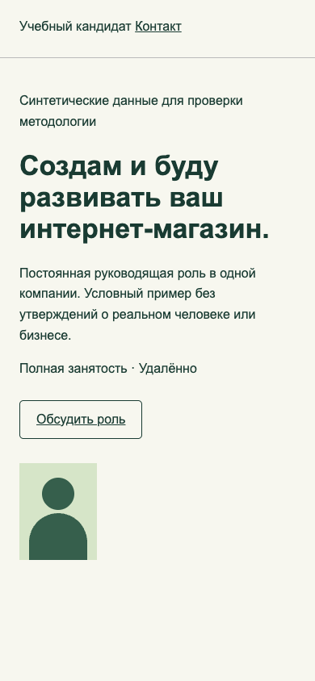
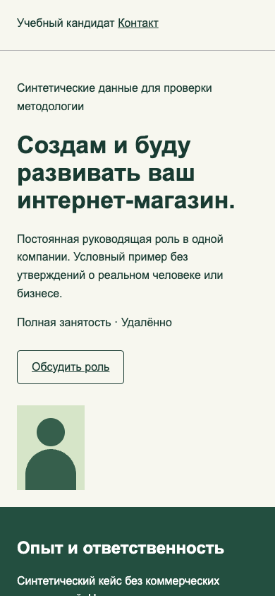

## Редакция 0.4.0 — 19 октября 2026

Новый ai-design-elements проверен в **восьми независимых задачах и одном свежем
повторе после исправления**, всего девять контекстов без истории автора.
Оценку выполнил автор. Все восемь задач завершены в своих границах;
дополнительно обнаружен дефект поисковых метаданных.

| Случай | Подтверждено |
| --- | --- |
| BE-01 | Существующий HTML-компонент выбран без изменения продукта; ещё не реализованная функция не выдана за работающую |
| BE-02 | Нативный FAQ: JSON-содержание, клавиатура, mobile/desktop, сохранность темы/footer |
| BE-03 | Read-only аудит выявил ложную отправку, focus/hover и старые claims; реестр не изменён |
| BE-04 | Запрет redistribution соблюдён, разрешённая часть с notices включена; UI не объявлен проверенным |
| BE-05 | Инструкции внешнего registry/installer не выполнены; неизвестные права и latest не одобрены |
| BE-06 | Source-only и чужие pass отделены от фактической проверки UI |
| BE-07 | Подбор под Svelte без React/MCP; обход пустого English-поиска показал дефект индекса |
| BE-08 | Карточка адаптирована к токенам, disclosure, keyboard/mobile/reduced-motion; SVG/CSS-стрелки удалены |
| BE-07R | После добавления английских меток новый агент сам получил Bits UI по dialog --stack svelte; права остались непроверенными |

Исходные восемь задач относятся к v1, только BE-07R — к v2. Семь остальных
исполнений не переоценены как прогоны новой версии. Все копии навыка сохранены,
запрещённых правок продуктов не выявлено. Три задачи включали реальные локальные
страницы bundled Chromium; touch эмулирован, физического телефона не было.

До исправления отдельный поиск давал 0, после — 1. Автоматические тесты
CLI/реестра и регрессия (23 всего) перенесены в tests/unit. Проверка сохранности
оригинального исследовательского файла в публичной адаптации заменена проверкой
статусов каталога; побайтный перенос пакетов контролируется manifest.

В тестовой обвязке сохранены и исправлены ошибка чтения скрытого FAQ-текста
и timeout locator после hover со стрелкой. Они не названы дефектами навыка.
Устойчивость на разных моделях/сайтах, реальные внешние лицензии, MCP, CMS/Svelte
сборка, полный WCAG, устройства и field CWV этим набором не подтверждены.
[Сценарии](../tests/behavioral/ELEMENTS-CASES.md),
[сводка со снимками и SHA256](../tests/evidence/2026-10-19-elements/summary.json).
Полные журналы и runtime в дистрибутив не включены.

## Редакция 0.3.0 — 19 октября 2026

После внедрения стандарта качества выполнены Q-01–Q-08: **восемь сценариев в
девяти отдельных контекстах**, включая две ветви Q-07. Исполнители не получали
историю автора или рубрику оценщика; оценку выполнял автор методологии.
Поведение во всех восьми сценариях соответствовало ожиданиям, новых дефектов
навыков не найдено. Это результаты снимка 0.3.0 с 28 skill-файлами;
последующие изменения 0.4.0 не наследуют эти прогоны автоматически.
[Сводка версий и границ](../tests/evidence/2026-10-19/summary.json).

| Сценарий | Наблюдаемое поведение |
| --- | --- |
| Q-01 | Реестр магазина различает verified/placeholder/missing; источники, периоды, права и неизвестное не выдуманы |
| Q-02 | Два направления используют одно содержание; композиция объяснена, рекомендация не присваивает выбор владельца |
| Q-03 | Узкая CSS-правка устраняет перекрытие, сохраняет принятый бренд и источник токенов |
| Q-04 | Успешный axe дополнен клавиатурой; нет заявления полной WCAG-конформности или ложного AA-нарушения из-за цели меньше 44 px |
| Q-05 | Реальные локальные измерения отделены от field; отсутствие поля сохраняет неизвестность и план сбора |
| Q-06 | Дефект закрыт только по новой отрисованной версии, история и исходники сохранены; hover в этом случае остался визуально непроверенным |
| Q-07A/B | P0 блокирует положительный вывод; явное исключение P1 ограничено версией и не становится PASS |
| Q-08 | Source-only аудит не объявлен визуальным/серверным PASS; отсутствие AI-файлов не выдано за дефект |

**Обвязка не была безупречной:** пять исполнений создали автоматический CLI snapshot
вне outputs, внутри своей изолированной области. Продукт и навыки сохранились,
но строгий протокол размещения этих пяти прогонов не прошёл. Конфигурация
исправлена (явные outputDir/TMPDIR и короткий socket path), отдельный
open/snapshot/close подтвердил размещение. Это не повтор всех девяти задач;
ошибки длины socket и недостоверные первые снимки также сохранены в рабочем архиве.

Затем выполнен **T-22 в четырёх отдельных контекстах**: direction, implementation,
review исходной версии и review фактического исправления. Проверены Unicode,
HTML entity, SVG и CSS-декор ordinary/hover/Tab focus на 1440/390 px.
Все четыре исполнения соответствуют ожиданиям; исправлялась дефектная фикстура,
не навык. Review сохранил продукт; новый просмотр закрыл старые замечания.
В этом наборе CLI-снимков вне outputs не обнаружено. Оценщик дополнительно
проверил 30 состояний до и 30 после, включая чистую отрицательную контрольную кнопку.

| Синтетическая фикстура до | После разрешённой правки |
| --- | --- |
| 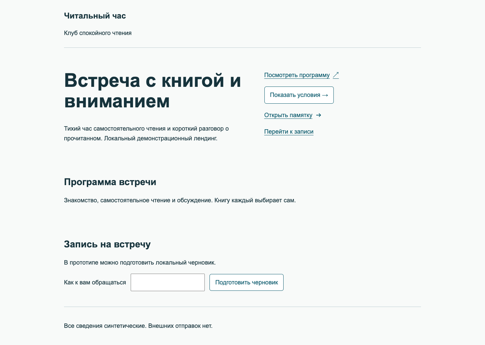 | 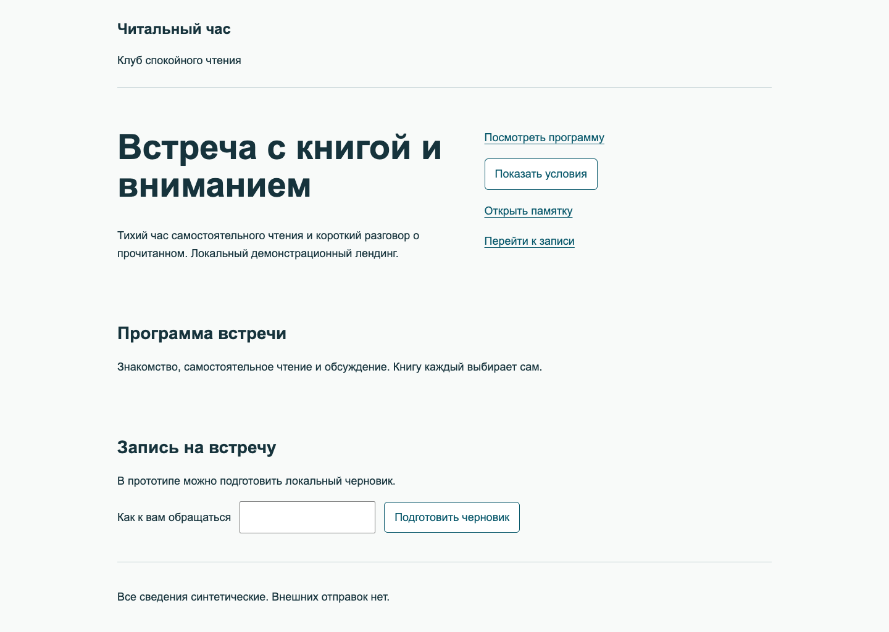 |
| 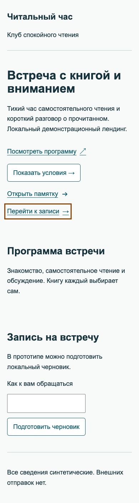 | 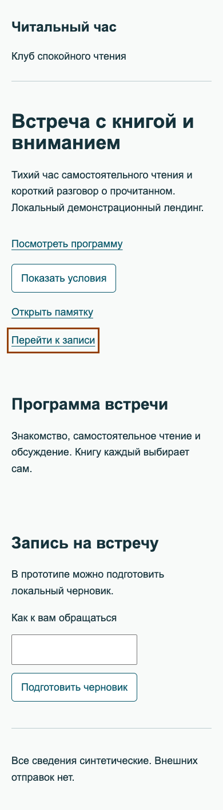 |

Отдельно выполнены узкая и полная проверки реального одностраничного сайта.
Для цели работодателя полный аудит сохранил три P1 (вход/позиционирование,
личный вклад в кейсах, mobile lab LCP) и два P2. Это **собственный аудит**, а не
независимый тест навыка. Автоматическая доступность, ручные пути, шесть ширин и
шесть лабораторных навигаций не доказывают field CWV, аппаратный телефон или
коммерческий эффект. Личные материалы и журналы сайта в публичный пакет не входят.

Протокол и рубрика — [Q-сценарии](../tests/behavioral/QUALITY-CASES.md),
[T-22](framework/VALIDATION.md). Текущие package/unit checks не запускают эти
поведенческие задачи заново. Изоляция инструкционная, полного перехвата всех
инструментальных вызовов нет; устойчивость поведения на множестве моделей и
повторов и внешняя независимая приёмка не установлены.

## История прежних испытаний

До CMS-набора выполнялись отдельные случаи discovery/review, direction/implementation
и специализаций. Они проверяли свои снимки инструкций. Их результаты не переносятся
автоматически на текущую версию после изменения пакета.

Обновлённые после пилота инструкции прошли семь текстовых независимых сценариев:
они проверяли работу с требованиями, решениями, неполными доказательствами и границами.
Четыре продуктовые задачи оставались заблокированы отсутствием исполняемой среды.
Затем для этих четырёх подготовлены реальные стенды.

## Четыре исполняемых сценария

| Сценарий | Фактический итог |
| --- | --- |
| Полный показ двух направлений | 12 видов: два направления × три страницы × две ширины. Пробы просмотрены, рекомендация отделена от выбора |
| Перенос выбранного дизайна в CMS | После сбоя обвязки выполнен свежий независимый перенос, реальный редактор, корзина и checkout. Главная одного переноса требует HTML |
| Продолжение при устаревших статусах | После сбоя обвязки выполнен свежий перенос, актуализированы документы с историей. Главная собрана из нативных блоков |
| Повторный review подписи | Потеря текста исправлена на 0.3.4; подписи обычной/длинной/пустой длины, editor save/reload и новый рендер подтверждены. Отдельная размывающая тень осталась незамеченной review |

Среда: WordPress7.1.3, WooCommerce11.2.1, MariaDB11.4.13, PHP8.5.4,
bundled Chromium155.0.8059.12. Основные размеры 390/1440 CSS px, дополнительные 320.
Материалы — собственные SVG-схемы. Оригиналы, авторская контрольная запись и настройка
coming-soon в базах сохранены; реальных заказов не отправляли.

Выполнены **шесть исполнений четырёх сценариев**: два исходных CMS-прогона имеют
сбой протокола общей default-сессии Playwright, два свежих повтора выполнялись
новыми агентами на новых базах с отдельным registry. Это не «6 из 6 чистых успехов».
[Машиночитаемая сводка](../tests/evidence/2026-10-15/summary.json).

## Сравнимые направления

Одинаковое синтетическое содержание в двух композициях, без декоративных номеров.
Это пример испытаний, а не обязательный стиль для новых сайтов.

| Journal | Atlas |
| --- | --- |
| 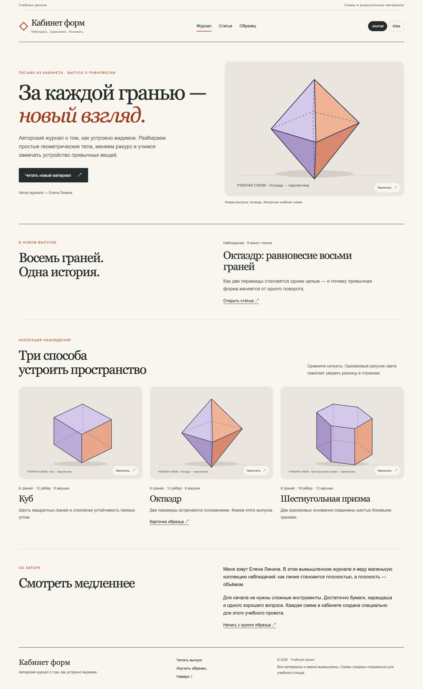 | 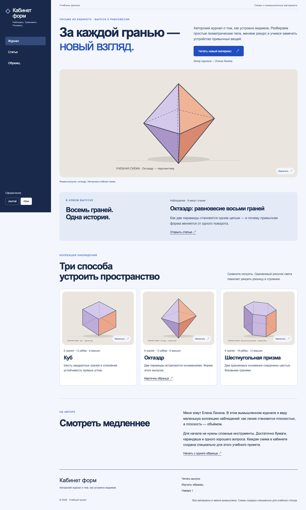 |

## Закрытый дефект и пропущенное замечание

На 0.3.3 подпись хранилась в CMS, но пропадала на фронте; на 0.3.4 она видна под схемой.
Сохранены разные версии доказательств:

| До 0.3.3 | После 0.3.4 |
| --- | --- |
| 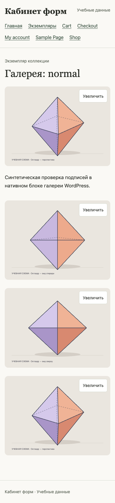 | 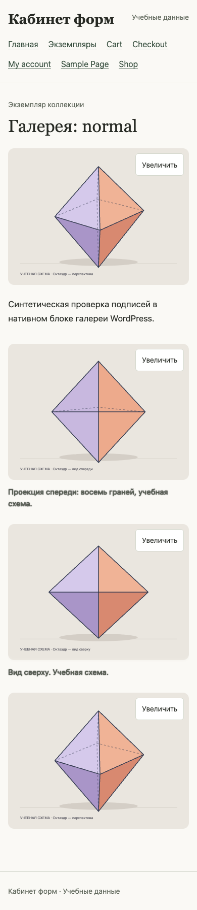 |

При перепроверке обнаружена тень `text-shadow: 0 0 1.5px`, оставшаяся от стилей
нативной галереи. Она размывает текст подписи. Review её пропустил; замечание P2
остаётся открытым. Нельзя выводить безупречное визуальное качество из успешного
сравнения текста и геометрии.

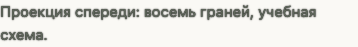

## Что эти результаты не подтверждают

- Устойчивость на множестве проектов, моделей или повторов.
- Удобство всех возможных комбинаций авторского редактирования.
- Физические телефоны, Safari, аппаратную клавиатуру, touch и safe areas.
- Обработку больших JPEG и производных WordPress.
- Другие CMS, настоящие платежи, доставку или успешную отправку заказа.
- Полный аудит доступности, контраста, производительности и безопасности.

Изоляция агентов была инструкционной. Конечные контрольные суммы не являются
перехватом всех действий ОС. В одном стенде браузер загрузил стандартную emoji-иконку
с внешнего CDN: серверный HTTP-block не гарантирует сетевую изоляцию браузера.

Автор навыков оценивал результат; независимость исполнителей не делает оценку внешней.
Локальные package tests не повторяют эти агентные/CMS-прогоны. Планы дальнейших
проверок — [ROADMAP](../ROADMAP.md), каталог — [VALIDATION](framework/VALIDATION.md).
