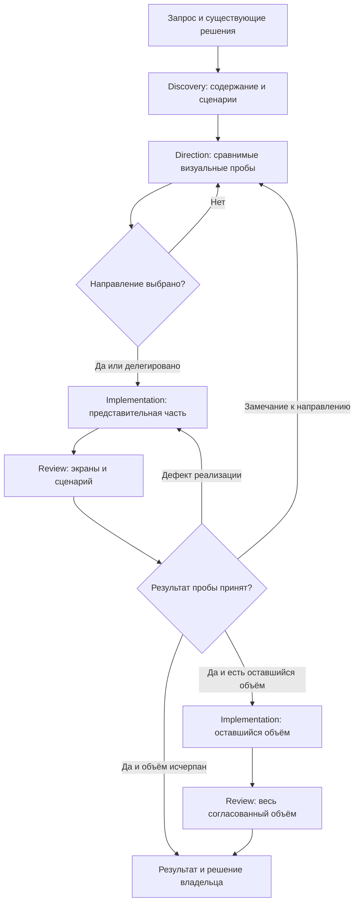

# Маршруты работы AI Design Framework

Редакция 0.2 · 15 октября 2026 года.

Маршрут выбирается по запросу и состоянию проекта. Тип сайта — лендинг,
сайт услуг, редакционный сайт или магазин — уточняет содержание и проверки,
но не заставляет проходить все этапы. Условия работы навыков заданы
в [контрактах](CONTRACTS.md), сценарии испытаний — в [плане проверки](VALIDATION.md).

Дополнение 19 октября 2026: [стандарт качества](QUALITY.md) применяется внутри
этапов, не создавая новый обязательный маршрут. Content/IA входят в discovery,
структурное сравнение — в direction, функциональная проверка — в implementation
и review, визуальная приёмка остаётся у владельца. Это логические роли,
а не требование запускать дополнительных агентов.

## Выбор маршрута

1. Определите ожидаемый результат: исследование, выбор стиля, реализация,
   исправление или отчёт. Явно заданный объём имеет приоритет.
2. Прочитайте действующие решения и определите, чего не хватает именно для этой задачи.
3. Выберите маршрут из таблицы. Пропускайте уже выполненные этапы при достаточных
   и актуальных результатах; укажите, на что опираетесь.
4. Выполняйте разрешённую часть. Вопрос владельцу нужен, когда неизвестное
   существенно меняет решение и не покрыто ранее данным делегированием.

Выбор маршрута пока выполняет агент по этой таблице. Отдельный входной навык
`ai-design` можно реализовать позже; он не входит в четыре основных контракта.

| ID | Запрос и состояние | Последовательность | Где закончить |
| --- | --- | --- | --- |
| R-01 | Новый сайт, полного решения ещё нет | discovery → direction → выбор направления → implementation пробы → review пробы → приёмка пробы → implementation оставшегося объёма → review | На результате, который заказал пользователь; полный запрос завершается проверкой согласованного сайта |
| R-02 | Редизайн существующего сайта | discovery текущего состояния и причин изменения → direction только изменяемой части → implementation пробы → review → распространение при необходимости | Сохранить действующее вне согласованных изменений, проверить затронутые сценарии |
| R-03 | Локальная правка при известной системе | implementation → review затронутого экрана и поведения | На исправлении и проверке; исследование и варианты стиля не требуются |
| R-04 | Нужен только аудит | review | Отчёт; исходники продукта остаются без изменений |
| R-05 | Нужны только исследование или направления | discovery либо direction с необходимым контекстом | На запрошенных документах или вариантах; работа над сайтом не начинается автоматически |
| R-06 | Реализация по утверждённому макету или действующей системе | implementation → review | Проверить точность переноса и сценарии; новый выбор стиля не требуется |
| R-07 | Продолжение после паузы или замечаний | проверить актуальность входов → выбрать затронутый этап → повторить зависимые проверки | На актуальном результате с обновлёнными доказательствами и сохранённой историей решений |

В R-01 пробы направления — изолированные визуальные эскизы, а проба реализации —
работающая представительная часть целевого сайта. Для небольшого лендинга пробой
реализации может быть вся страница: второй экземпляр реализации не нужен.
Этапы выбора и приёмки опираются на существующее решение владельца или делегирование;
они не требуют повторного подтверждения уже согласованного действия.

Выбранная HTML-проба и поручение перенести её в тему CMS относятся к R-06.
Нужна техническая проверка на реальных шаблонах и редактируемых данных, а не новый
выбор направления. Пилот внутри разрешённого переноса не создаёт дополнительной
точки согласования; необходимость нового решения должна быть конкретной.

## Полный маршрут

Для подбора/переноса элемента или аудита его происхождения доступен
`ai-design-elements` ([объём и режимы](ELEMENTS.md)). Подбор в direction
не разрешает установку в продукт, review сохраняет исходники, implementation
использует существующие компоненты и согласованный объём. Отдельного этапа нет.

Внутри R-03/R-04/R-06 доступны [специализации](SPECIALIZATIONS.md): `break-ui`
для крайних данных, `mobile-native` для мобильного поведения. Режим основного
этапа сохраняется: R-04 не меняет продукт, подготовка стенда и исправления имеют
разные области записи. Они не добавляют обязательных этапов новому сайту.

Это схема переходов, а не автоматический цикл генерации. Если выбор ещё не сделан,
представьте варианты и ожидайте решение, сохранив результат. Повторные попытки
при инструментальной ошибке ограничиваются диагностикой и полезной альтернативой.

## Содержание и проверка по типам сайтов

| Тип | Что определить до выбора стиля | Что проверить на представительном результате |
| --- | --- | --- |
| Лендинг | Предложение, аудитория, основное действие, реальное содержание и путь до результата | Вся страница, мобильная композиция, CTA, якоря и форма с её состояниями, если они есть |
| Сайт услуг | Услуга, кому она подходит, условия и подтверждённые доказательства | Страница услуги и путь обращения; навигация между страницами, если она входит в задачу |
| Редакционный сайт | Типы материалов, структура чтения и поиска, роль изображений | Список или коллекция и материал; длинный текст, изображения и поиск при наличии |
| Интернет-магазин | Сущности каталога, свойства товара, выбор и условия покупки | Каталог, карточка и заданный путь к заказу; варианты товара, отсутствие наличия и ошибки при применимости |

Представительная часть выбирается по риску и основному сценарию, а не обязательно
по главной странице. Полная приёмка покрывает согласованные типы страниц и состояний;
одна красивая главная не подтверждает качество каталога или оформления заказа.
В гибриде «коллекция + магазин» показ объекта коллекции сам по себе не означает,
что он продаётся.

## Возврат после изменения или замечания

| Триггер | Куда вернуться | Что пересмотреть | Что сохранить |
| --- | --- | --- | --- |
| Изменились аудитория, предложение или основное действие | discovery | Бриф, структуру и зависимые решения | Проверенные исходные данные, не затронутые изменением |
| Не подходит характер подачи, типографика или композиция | direction | Конкретную часть направления и её реализацию | Бриф и остальные принятые решения |
| Кнопка перекрыта, меню не открывается, сетка ломается | implementation | Дефект и связанные проверки | Направление и незатронутый код |
| Не хватает просмотра, состояния или подтверждения результата | review либо получение доказательств через implementation | Покрытие и вывод отчёта | Наблюдения, которые остаются актуальными |
| Изменились фотографии, язык, объём текста или компоненты после одобрения | ближайший затронутый этап | Соответствие дизайну и применимые проверки | Независимые решения и историю прежнего одобрения |

Перед существенной переделкой сформулируйте причину и область изменения.
После исправления повторите затронутые проверки, а не весь процесс по умолчанию.
Если замечание допускает несовместимые трактовки, покажите конкретные варианты
интерпретации и уточните выбор. Решения не приписываются владельцу по молчанию.

## Продолжение между сессиями

В документах текущего этапа или принятом журнале проекта сохраните:

- запрос и маршрут, текущий объём и целевой проект;
- результаты этапов и их версии;
- решения владельца и границы делегирования;
- ссылку на действующие требования владельца и способ проверки каждого применимого условия;
- открытые ограничения и устаревшие доказательства;
- ссылку на реестр содержания и его пробелы; состояние матрицы качества,
  открытые P0/P1 и источники допустимых исключений;
- следующее допустимое действие.

После смены этапа обновляйте текущие статусы в связанных документах; устаревшее
«выбор не получен» не должно оставаться действующим рядом с выбранным направлением.
История сохраняется с датой, без распространения старых проверок на новую сборку.

Перед продолжением проверьте, что входы и исходники не изменились.
При изменении версии старые скриншоты остаются историческими материалами;
их применимость к текущему результату требуется подтвердить.

## Границы приёмки

Проверка пробы отвечает, можно ли распространять решение на оставшийся объём.
Проверка сайта отвечает, что выполнено и проверено в согласованном объёме.
В обоих случаях визуальное решение владельца записывается отдельно.
Положительная техническая рекомендация ограничена проверенным объёмом:
нет P0, P1 исправлены либо имеют явное допустимое исключение, обязательные
проверки выполнены. Непроверенное не превращается в успех. Для нового сайта
без field CWV указываются недостаток данных и план измерений, а не автоматический отказ.
Неисследованные устройства, формы и интеграции остаются открытыми ограничениями.
Публикация, подключение платных сервисов и другие внешние действия выполняются
только в разрешённых пользователем границах.
